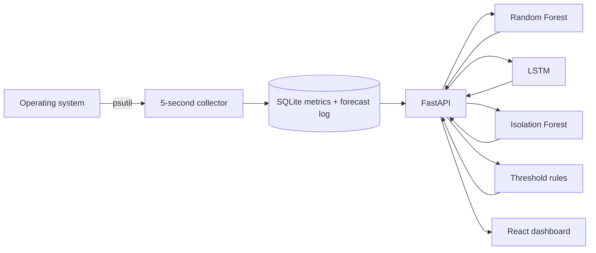

# SysSense AI - Project Review 3 Preparation

## Project and team

| Project detail | Value |
|---|---|
| Project title | SysSense AI - AI-Powered Operating System Resource Monitoring, Prediction and Optimization Platform |
| Course | Operating Systems Lab |
| Institution | VIT Vellore |
| Academic year | 2026-27 |
| Team | Rohan Kumar (24BDS0463), Shreyans Bohra (24BCT0013) |
| Faculty guide | Dhivyaa C R |
| Slot | L39 + L40 |

## 1. Presentation-safe summary

SysSense AI collects live CPU, RAM, disk, network, process, and thread
information with `psutil`; stores collector readings in SQLite; serves them
through FastAPI; and renders them in React. The live resource cards are direct
operating-system telemetry. Random Forest and LSTM models are trained on the
project's mapped 10,000-row Kaggle dataset and make nominal 30-second CPU/RAM
estimates. Isolation Forest provides a separate experimental anomaly signal,
while high-resource process alerts are transparent threshold rules.

The project must not present a generic ML/DL "accuracy" percentage for CPU or
RAM because forecasting is regression. The correct benchmark measures are MAE,
RMSE, and R2. The dashboard now also logs each prediction and matches it to
the first real collector reading at least 30 seconds later, so the faculty can
see measured local forecast error rather than an unsupported live-accuracy
claim.

## 2. What is live, what is model output

| Dashboard item | Source | Correct presentation statement |
|---|---|---|
| CPU, RAM, disk, network cards | Direct `psutil` snapshot | Live OS telemetry at the time of the API request |
| Charts | SQLite readings written by the collector | Historical local telemetry |
| Random Forest and LSTM values | Dataset-trained models using collector-compatible features | Experimental 30-second estimates |
| Disk value on Prediction page | Direct `psutil` snapshot | Live disk usage, not a forecast |
| System/process alerts | Explicit resource thresholds | Rule-based warning, not an ML anomaly |
| Anomaly status | Dataset-trained Isolation Forest | Experimental anomaly signal; review precision, recall, F1 and baseline accuracy together |
| Live Forecast Evaluation | `forecast_log` matched against later collector readings | Measured local error after forecasts mature |

## 3. Architecture



The collector records a snapshot approximately every five seconds. The backend
uses a short positive CPU sampling interval and cache, so a first dashboard
request does not display psutil's non-blocking `0.0%` sentinel value. Each
saved ML/DL artifact has a versioned 24-feature collector-compatible contract;
inference is disabled if an artifact expects unavailable features rather than
inventing missing values.

## 4. Dataset and feature engineering

The faculty-required training source is preserved: the repository contains
`ml/data/Big_data_dataset.csv` and a mapped
`ml/data/system_metrics_dataset.csv`, both with 10,000 rows. Project code
attributes the source to Kaggle's [IT System Performance & Resource Metrics
dataset](https://www.kaggle.com/datasets/freshersstaff/it-system-performance-and-resource-metrics).
Record the exact download version and licence before external publication.

The mapped CSV is a benchmark, not a trace from the demonstration computer.
Its timestamps are assigned five seconds apart by `generate_dataset.py`; a
six-row target is therefore a nominal 30-second horizon. The live collector
now follows approximately the same five-second cadence, and real local
accuracy is evaluated separately after deployment.

The common Random Forest/LSTM feature profile contains 24 inputs that the
collector actually records:

| Feature group | Inputs |
|---|---|
| Current values | CPU, RAM, disk |
| History | CPU/RAM lags at 1, 3, and 5 samples |
| Trend | CPU/RAM moving averages at 5 and 10 samples |
| Change/variation | CPU, RAM, disk deltas; CPU/RAM 5-sample standard deviations |
| Network | Sent and received cumulative-counter rates |
| System activity | Thread count and process count |
| Time | Hour and minute |

CPU and RAM targets are shifted six samples forward. Feature engineering
produces 9,985 usable rows. Random Forest uses a chronological 80/20 split
with a six-sample embargo: 7,982 training rows, 6 omitted boundary rows, and
1,997 final test rows. Hyperparameter selection uses
`TimeSeriesSplit(n_splits=3, gap=6)`.

The LSTM uses a 10-row sequence over the same 24 features. It uses a
chronological 70% training / 10% validation / 20% final-test split, with a
six-sample embargo at both boundaries. `StandardScaler` is fitted only to
the training partition, and early stopping uses validation only.

## 5. Benchmark evaluation results

### Random Forest

| Target | MAE | RMSE | R2 | Persistence MAE | MAE reduction |
|---|---:|---:|---:|---:|---:|
| CPU | 23.0233 | 26.8685 | -0.0052 | 31.3095 | 26.47% |
| RAM | 22.6682 | 26.2040 | -0.0123 | 30.3470 | 25.30% |

### LSTM

| Target | LSTM MAE | LSTM RMSE | LSTM R2 | Persistence MAE | Persistence RMSE |
|---|---:|---:|---:|---:|---:|
| CPU | 22.9939 | 26.8115 | -0.0008 | 31.2902 | 38.1449 |
| RAM | 22.5530 | 26.0690 | -0.0022 | 30.3418 | 36.9204 |

These values are reproducible benchmark results from the current artifacts:
`ml/evaluation_report.md` and `ml/dl_evaluation_report.md`. The lower MAE
than the persistence baseline is useful comparative evidence, but negative R2
means the models should not be described as reliable operational forecasts or
as "accurate" without the live evaluation evidence.

## 6. Anomaly-detection evaluation

The Isolation Forest uses 10 collector-compatible inputs and a chronological
80/20 holdout, then is refit on all rows for deployment.

| Measure | Held-out result |
|---|---:|
| Accuracy | 98.15% |
| Balanced accuracy | 58.88% |
| Precision | 25.00% |
| Recall | 18.52% |
| F1 | 21.28% |
| Confusion matrix | TN=1,958; FP=15; FN=22; TP=5 |
| All-normal baseline accuracy | 98.65% |

This is an imbalanced problem. The all-normal baseline has higher accuracy than
the detector, and the detector misses 22 of 27 labelled anomalies. Therefore,
do **not** use “98.15% accurate anomaly detection” in the viva. Present the
precision, recall, F1, confusion matrix, and the baseline together. Process
resource warnings are intentionally labelled as threshold signals; Windows
`System Idle Process` is excluded so it is not shown as a false high-CPU
anomaly.

## 7. Live forecast validation

When `/predict` returns an ML/DL forecast, the backend stores:

- the source collector sample,
- the predicted CPU/RAM values,
- the target time 30 seconds later, and
- the first later collector reading used as the actual result.

`GET /predict/evaluation` calculates live MAE, RMSE, R2, and the percentage
within +/-5 percentage points for completed forecasts. The Prediction page
shows these values under **Live Forecast Evaluation**.

Use this wording in the demo:

> “The models were trained on the required dataset. These are the benchmark
> results. For this computer, we do not claim accuracy before measuring it; the
> application logs forecasts and compares them with later live readings here.”

Do not quote local metrics until at least 30 matched forecasts have accumulated
under ordinary use. Treat a small sample as preliminary, and compare against
the persistence baseline before claiming improvement.

## 8. Demonstration procedure

Start each command in a separate terminal from the repository root.

```powershell
cd backend
..\.venv\Scripts\python.exe collector.py
```

```powershell
cd backend
..\.venv\Scripts\python.exe -m uvicorn main:app --reload
```

```powershell
cd frontend
npm run dev
```

Wait at least one minute after starting the collector so the prediction models
have the ten history rows required for their feature windows. Then:

1. Show Dashboard CPU, RAM, disk, and network cards and say they are live OS telemetry.
2. Open Process Manager and explain PIDs, process states, CPU, and memory.
3. Open Prediction. Distinguish the live disk card from the CPU/RAM model estimates.
4. Show **Live Forecast Evaluation** after forecasts have matured for 30 seconds.
5. Open Alerts. Explain system/process threshold rules separately from the ML anomaly signal.
6. Open `http://localhost:8000/docs`; show `/metrics/current`, `/predict`, and `/predict/evaluation`.
7. Capture dated screenshots and record the machine/OS used for the demo.

## 9. Viva answers

| Likely question | Evidence-based answer |
|---|---|
| Why train on a dataset? | The faculty requirement is met using the mapped Kaggle dataset. It provides a reproducible benchmark; live validation is a separate deployment check. |
| Are CPU/RAM values live? | Dashboard telemetry comes directly from psutil. CPU/RAM model values are separately labelled experimental forecasts. |
| Why no forecast accuracy percentage? | CPU/RAM are continuous regression targets. MAE, RMSE, and R2 are appropriate; any tolerance rate must state its threshold. |
| How is live accuracy checked? | A prediction is persisted and matched with the first collector sample at least 30 seconds later; the API computes live error. |
| Why use both RF and LSTM? | RF is a tabular baseline using engineered lags/trends; LSTM receives ten ordered feature rows to model sequence information. |
| Is the anomaly detector 98.15% accurate? | No strong claim follows from that number: the all-normal baseline is 98.65%, recall is 18.52%, and F1 is 21.28%. |
| What does negative R2 mean? | On the held-out dataset split, the prediction did not outperform the test-set mean under R2, even though it lowered MAE against persistence. |
| What prevents a false System Idle Process alert? | It is excluded from process resource rules because its reported idle percentage is not real CPU consumption by a workload. |

## 10. Limitations and next steps

1. Record the dataset's exact version, download date, and licence.
2. Collect labelled local workload traces under documented CPU/RAM stress scenarios.
3. Accumulate sufficient matched forecasts and compare live ML/DL error with persistence.
4. Consider local calibration/retraining only after keeping a separate unseen local test period.
5. Improve anomaly labels and tune the detector for recall/precision rather than headline accuracy.
6. Update all slides from the current reports and feature contract: 24 features, not the legacy 27-feature artifacts.

## Evidence files

- `ml/evaluation_report.md` - Random Forest benchmark evaluation
- `ml/dl_evaluation_report.md` - LSTM benchmark evaluation
- `ml/anomaly_evaluation_report.md` - anomaly holdout evaluation
- `backend/routes/predict.py` and `backend/database.py` - live forecast matching
